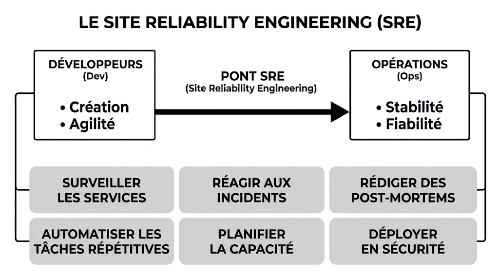
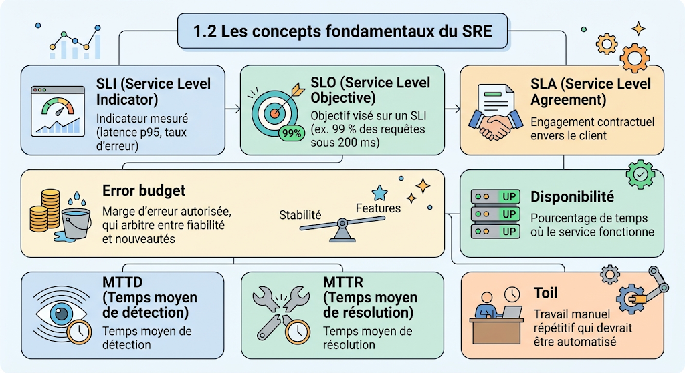
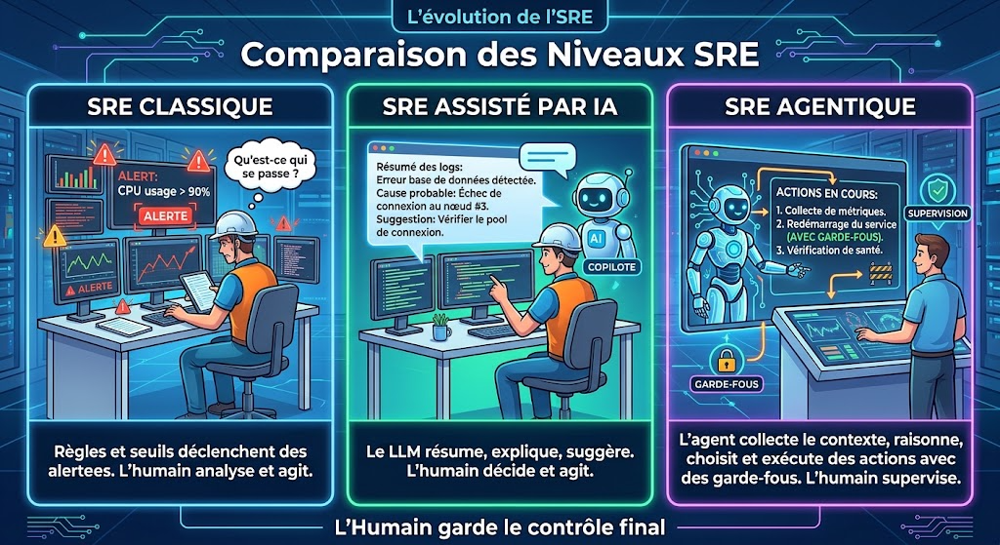

# SRE Agent AIOps

Agent IA de supervision qui surveille un service d'inférence ML sur Kubernetes,
diagnostique les incidents et propose ou applique une remédiation.

## 1. Contexte : SRE et AIOps

Cette partie présente le métier de SRE, ses concepts clés, puis l'évolution
vers l'IA agentique, qui est le cœur de notre projet.

### 1.1 Que fait concrètement un ingénieur SRE ?

  
   
  <em>Figure 1 : Les activités d'un ingénieur SRE</em>

Le **SRE (Site Reliability Engineering)** applique les méthodes du génie
logiciel à l'exploitation des systèmes, afin de garantir des services
fiables, disponibles et performants. Cette approche est née chez Google.

Lors d'un incident, le travail est largement manuel : lire les métriques,
fouiller les logs, formuler une hypothèse, agir. C'est cette charge que notre agent cherche à réduire.

### 1.2 Les concepts fondamentaux du SRE

  
   
  <em>Figure 2 : SLI, SLO, MTTD, MTTR et cycle de vie d'un incident</em>

| Concept | Définition |
|---|---|
| **SLI** | Indicateur mesuré (ex. latence p95, taux d'erreur) |
| **SLO** | Objectif visé sur un SLI (ex. 99 % des requêtes sous 200 ms) |
| **SLA** | Engagement contractuel envers le client |
| **Error budget** | Marge d'erreur tolérée avant de geler les nouveautés |
| **MTTD** | Temps moyen de **détection** d'un incident |
| **MTTR** | Temps moyen de **résolution** d'un incident |

Un incident suit toujours le même cycle : **détection → diagnostic →
remédiation → vérification → post-mortem**. Il s'appuie sur les trois
piliers de l'observabilité : **métriques, logs et traces** (auxquels
s'ajoutent les événements Kubernetes).

> **MTTD et MTTR sont les deux indicateurs que nous mesurons dans ce projet.**

### 1.3 De l'IA classique à l'IA agentique en SRE

  
   
  <em>Figure 3 : Du SRE classique au SRE agentique</em>

L'autonomie de l'agent apporte de nouveaux risques (erreurs du LLM, actions
destructrices). Nous les encadrons par quatre garde-fous obligatoires :
**dry-run, validation humaine, permissions minimales (RBAC) et journal d'audit**.

**En résumé :** l'approche agentique promet de réduire le MTTD et le MTTR,
à condition d'encadrer l'autonomie de l'agent.

---

## 2. État de l'art

